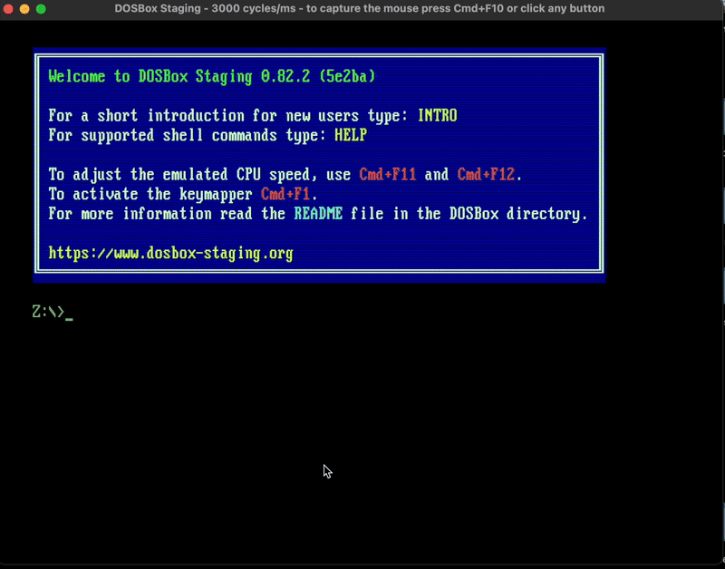

## Mac (M1) Setup

- Install DOSBox Staging: https://www.dosbox-staging.org/

Create a folder for your assembly files. Run this in the macOS terminal:

```bash
mkdir -p ~/dos/asm
```

Mount that folder as the C drive. Run this inside DOSBox:

```
mount c ~/dos/asm
c:
```

- Get `jwasm.exe` and `link.exe` (a MASM-compatible assembler and a linker) and put them in the folder.

Assemble and run your program inside DOSBox:

```
jwasm -mz hello.asm
hello
```



## VS Code

- Extension: ASM Code Lens